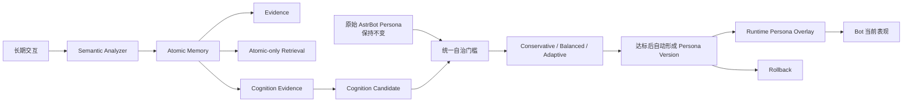
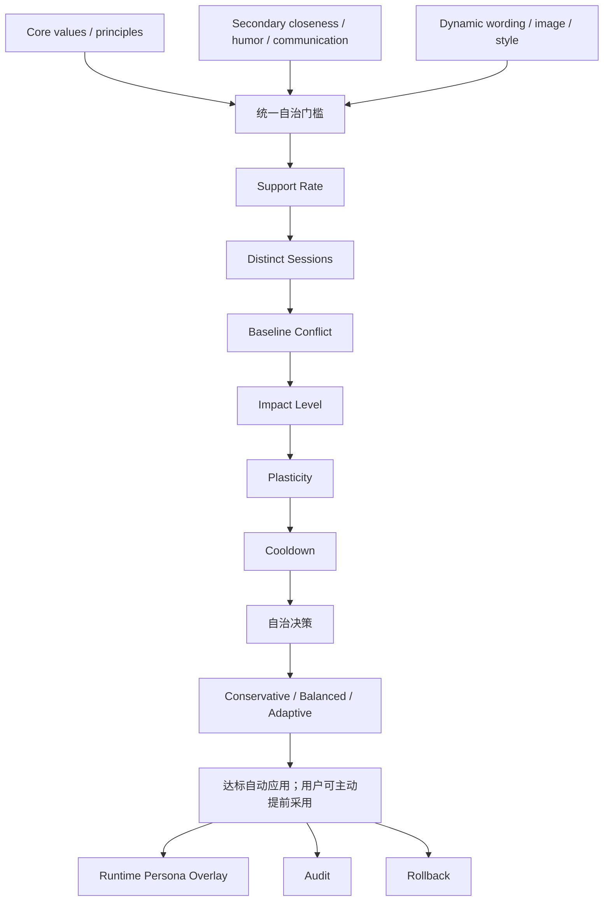
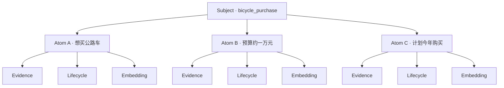
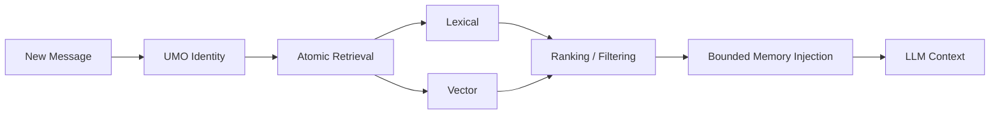

<p align="center">
  
</p>

<h1 align="center">微光回响 · Lumielle Echo</h1>

<p align="center">让 AstrBot Bot 在长期交互中形成记忆、自我认知与可受控演化的人格</p>

<p align="center">
  
  <a href="https://github.com/AstrBotDevs/AstrBot">= 4.22.0"></a>
  <a href="./LICENSE"></a>
</p>

微光回响把长期记忆作为基础，把自我认知与 Persona Evolution（人格演化）作为核心目标。它让 Bot 记住长期互动中的经历，形成对用户和自身的持续认知，并在统一门槛计算达标后自动形成 Persona Version（人格版本），进入 Runtime Persona Overlay（运行时人格覆盖层）。这不是静态画像或只供查看的标签：已应用的版本可能真实改变 Bot 的表达方式、行为倾向、互动关系和自我认知。

运行时 Persona Prompt 可能随已应用版本发生受控变化，但绝不会覆盖或改写 AstrBot 保存的原始 Persona 设置。原始 Persona 是 immutable baseline（不可变基线），始终保留用于冲突判断和回滚参考。

> **适用性提示**：微光回响的设计目标之一，就是允许人格在长期互动中发生真实但受控的变化。如果你要求 Bot Persona Prompt 永久严格固定、任何互动不得影响人格、人格必须始终与最初设定完全一致，Persona Evolution 并不适合这种需求。人格候选会按自治档位、证据和基线冲突继续观察；用户可以主动提前采用或否决候选，也可以回滚已应用版本。原始 AstrBot Persona 始终不变。

## 什么是 Persona Evolution

Persona Evolution 不是静态画像、用户标签或性格数值，而是让长期互动证据经过统一自治门槛计算后自动形成 Persona Version，并受版本、审计与回滚机制约束。Cognition Review 用于查看候选、提前采用或否决；系统正常演化不等待人工批准。

## 主要功能

### 长期记忆

从对话中筛选值得长期保留的内容，并按身份边界保存为可追踪的记忆。长期记忆不是整段聊天记录归档，而是让后续检索和人格机制都能引用的结构化基础。

## LivingMemory 与 Atomic Memory

微光回响的 Atomic Memory 底座基于并改编自 [LivingMemory](https://github.com/lxfight-s-Astrbot-Plugins/astrbot_plugin_livingmemory)。感谢作者 **lxfight**（参考版本 2.3.4）对 AstrBot 长期记忆和 Atomic Memory 的开源探索。

LivingMemory 的 Atomic 思想及部分模型和存储实现为本项目的重要基础；微光回响在此基础上围绕自我认知与受控 Persona Evolution 进一步扩展了 taxonomy、Cognition、<code>scope_key + umo_id</code> 隔离、独立 Evidence、五态 Lifecycle、TTL/decay、Atomic target authority、Persona Atomic references、Atomic-native write、Atomic-only retrieval、lexical/vector retrieval、Embedding、Multi-UMO Portrait、Atomic Structure/Lens、Cognition Review、Persona Version 和 Rollback。具体文件来源、许可证与改编范围见 [NOTICE](./NOTICE)。这是一种基于、改编并扩展的关系，不是对上游项目的比较性评价。

Memory Companion（作者：menglimi）是 migration architecture reference（迁移架构思想参考），不是本项目 Atomic implementation provenance（Atomic 实现来源）。

### Atomic Memory

Atomic Memory（原子记忆）把一段对话中的独立断言拆成多个 Atom（原子）。每个 Atom 拥有自己的 Type Path（记忆类型）、Subject（主题）、Evidence（证据）、Status（状态）、Confidence（置信度）、Importance（重要度）、TTL（有效期）、Embedding（向量索引）和 Lifecycle（生命周期），能够独立被强化、更新、休眠或取代。

### 记忆检索

新实例默认使用 Atomic-only Retrieval（仅原子召回），由 lexical retrieval（词法召回）和 vector retrieval（向量召回）两条路线共同排序；已有实例沿用当前配置。Embedding（向量索引）是可选的派生索引；未启用或暂时不可用时，lexical retrieval 仍可工作。召回结果会受到数量和字符预算限制，避免把不受控的大段历史直接注入上下文。

### 自我认知

Cognition（互动认知）是从长期证据中形成的、可审核的认知候选，不等同于给用户贴上的性格标签。它既可以描述关系与沟通方式，也可以记录 Bot 对自身身份、形象和表现方式的认知。

### Persona Evolution

Persona Evolution 按自治档位持续评估 Cognition Candidate（认知候选）；统一门槛达标后自动形成 Persona Version，并进入 Runtime Persona Overlay。Cognition Review 用于查看、提前采用或否决候选，不是系统继续运行的前置步骤。原始 Persona 保持不变，变化有证据、版本、审计和回滚路径。

### Multi-UMO

所有记忆、证据和 Persona 引用按 <code>scope_key + umo_id</code> 隔离不同平台、Bot、会话、用户和 Persona。一个 UMO 的内容不会因为主题或文字相同而自动合并到另一个 UMO。

### WebUI

提供 Overview（总览）、Memory（记忆）、Profile（用户画像）、Persona（人格）、Cognition（认知审核）、Versions（版本）和 Settings（设置）页面。Memory 页面包含 List View、Atomic Structure 和 Atomic Lens；Profile 页面提供确定性派生的 Memory Portrait。

### 用户操作入口与跨渠道闭环

Memory 页面中的 Atomic Lens 不只是浏览器。它提供三类明确的单条操作，但每次操作都必须绑定当前选定的 UMO（`scope_key + umo_id`）：

- **手动记住**：目前只允许 `fact.preference.like`、`fact.preference.dislike` 和 `fact.preference.habit`。提交后直接创建当前身份的 active Atomic Memory，并写入 `webui_manual_remember` Evidence；同一身份、同一类型、规范化后相同的 active 内容不会重复创建。
- **手动更正**：目前允许现有服务端支持的 `fact.preference.*` 事实，以及 `anchor.date.birthday` 和 `anchor.date.anniversary`。更正会创建带有手动来源的新 Atom，将旧 Atom 保留为 `superseded`；不会修改原始聊天记录、旧 Evidence 或历史审计。
- **手动遗忘**：对允许操作的非 Cognition Atom 执行生命周期转换为 `forgotten`，之后不再进入正常运行时召回。它不会物理删除原始聊天、Evidence 或 Lifecycle Event，也不会自动撤销已经应用的 Persona Version。

普通 Atomic Retrieval 只返回当前身份和当前生命周期下的运行时可见记忆；Atomic Lens 和历史审计仍可查看必要的状态、Evidence 与生命周期记录。相同文字在不同 UMO 中仍是不同记录，不会跨身份合并。

### 版本、审计与回滚

每次已应用的人格变化都形成 Persona Version，记录触发候选、差异、影响等级、当前状态和回滚关系。Cognition Audit（认知审计）保留决策轨迹；回滚会保留历史版本、使相关认知证据失效并建立冷却窗口，不会抹掉审计记录。

### Persona Growth（人格成长时间线）

Persona Growth 页面只读展示当前已应用的人格增量，以及从持久化 Candidate、有效 Evidence、Persona Version 和 Audit 记录投影出的成长时间线。版本详情可查看已保存的变化、自动采用或用户提前采用等来源、修订关联、回滚目标与影响说明，并分页查看 Version 创建时保存的触发来源。旧版本不会用 Candidate 后续 Evidence 补写；若同会话 Evidence 行后来被覆盖，无法恢复的历史元数据会明确标为不可用。时间线中的观察进度属于当前 Candidate，不是旧 Version 的历史快照。可读取的 Atomic 来源可跳转到 Atomic Lens。缺失的历史差异或来源会明确显示为未记录/不可用，不根据当前 Persona 状态猜造历史。该页面不改变门槛、审核、Persona Version 或回滚，也不调用 Provider。

## 对话如何形成长期记忆

每次对话由 Semantic Analyzer（语义分析器）判断是否形成长期记忆。它可以输出以下 operation（操作）：

- <code>create</code>：创建新的独立断言；
- <code>update</code>：对明确目标产生新版本，并保留旧 Atom 的生命周期关系；
- <code>reinforce</code>：为已有断言增加一次新的支持证据；
- <code>close</code>：将不再进行中的断言转入 dormant（休眠）；
- <code>forget</code>：按现有生命周期规则转入 forgotten（已遗忘），保留必要证据；
- <code>ignore</code>：本轮不持久化，不会制造 Atom。

分析器遵循 Independent Lifecycle Criterion：只有能够独立拥有主题、证据和生命周期的断言才拆成独立 Atom。拆分不是按标点机械切句，也不会为了增加数量而过度原子化，更不会从原文推断没有被表达的事实。

例如“我想买公路车，预算约一万元，最近睡眠不足”可能形成三个可独立追踪的断言：计划购买公路车、预算约一万元、最近睡眠不足。它们各自拥有自己的证据、状态、重要度和 TTL；如果语境不足以安全拆分，系统会保留更少的 Atom。

## Memory Pipeline

| Pipeline | 中文 | 典型内容 | 生命周期侧重点 |
| --- | --- | --- | --- |
| Fact | 事实 | 偏好、经历、身份资料、约定 | 通常长期保留，可按策略衰减 |
| State | 当前状态 | 情绪、睡眠、身体状态、短期任务 | 常有 TTL，过期后不再作为当前状态 |
| Anchor | 锚点 | 身份、生日、边界、明确承诺 | 稳定性较高，通常不自动衰减 |
| Cognition | 互动认知 | 价值观、原则、亲近度、沟通方式 | 继续积累证据并按自治门槛评估；审核页用于查看与主动覆盖 |
| Open Loop | 未完成事项 | 承诺、提醒、任务、未完成话题 | 追踪尚未闭合的互动事项 |

## Memory Lifecycle

每个 Atom 的状态独立记录：<code>active（活跃）</code>、<code>dormant（休眠）</code>、<code>expired（已过期）</code>、<code>forgotten（已遗忘）</code>、<code>superseded（已被取代）</code>。例如一条持续目标可以从 active 进入 dormant；明确的新版本出现时，旧 Atom 可以变为 superseded，而新 Atom 成为 active。

TTL 和 decay policy（衰减策略）只影响检索资格或状态判断，不会被 UI 统计悄悄延长。生命周期详情优先展示真实 transition（状态迁移）；没有迁移事件时只展示 Created（创建）基线和当前状态，不伪造数据库事件。

时间语义按类型策略区分：`state.*` 和临时 cognition 采用 Hard Expiry（硬过期）；事实、偏好等长期内容采用 Decay Only（仅衰减），旧的 `expires_at` 不会把仍为 active 的历史事实硬排除；`open_loop.*` 需要显式 Resolution（解决），锚点和持久 cognition 不因时间自动失效。这样“当前是否有效”和“过去是否发生过”不会混为一谈。

## Memory Maintenance（记忆维护）

Memory Maintenance（记忆维护）在普通正式 Retrieval 前按当前 UMO 自动运行两项确定性规则：兑现 Hard TTL 的 <code>active → expired</code> 过期，以及整理同身份、同偏好类型、规范化内容完全相同的活跃偏好。重复整理优先保留 native Atom、Evidence 较多者、再选择较小 ID；冗余 Atom 变为 <code>superseded</code>，Evidence 不搬移、不删除。每次变化都会记录 Lifecycle Event，精确整理另有专用历史和回滚入口。维护不调用 LLM/Provider；内部异常会记录并让当前聊天继续。Memory Workspace 仍提供只读 Preview 与显式 Hard TTL Apply 工具，但正常自治维护不依赖它们。

自治冲突治理补上了“内容发生变化”与“内容可以并存”的区分：明确指向同一独立事实变化的在线 Analyzer 动作会使用现有 Atomic <code>update</code> 路径；对有界本地发现出的同槽位、偏好极性或词法相似候选，正常分析提交后由当前 Chat Provider 判断为 <code>replacement</code>、<code>coexist</code> 或 <code>deferred</code>。Replacement 在事务内保留旧 Atom 并写入生命周期事件，可从维护历史回滚；Coexist 不改变生命周期；Deferred 继续保留候选，注入时明确提示运行时不要擅自选出唯一事实。新 Evidence 或候选成员/内容变化后可重新评估；相同分组与 Evidence 版本不会重复调用 Provider。单次处理有界，不会对全库做 N² 语义比较，也不建立人工审核队列。维护页提供历史查看、Atom 导航与 replacement 回滚；`cognition.*` 不参与这套记忆冲突自动处理。

### Memory Quality Governance（记忆质量治理）

Phase 15 冲突判断先区分事实取代、可共存和未决；随后质量治理只在当前 UMO、近期有限窗口、非 Cognition、类型族兼容且有实际词法重叠的少量候选中判断语义关系。Phase 15 的 `replacement`、`deferred` 和仍未解除的回滚组不会进入语义等价判断；`coexist` 仍可进入独立的质量判断，因为“可以同时为真”不等于“不是同一条事实的重复记录”。

质量关系分为 `equivalent`（同一独立长期断言的重复碎片）、`related_distinct`（相关但各有独立生命周期）和 `observing`（证据不足）。只有 `equivalent` 会按确定性顺序保留一个 canonical Atom，并将冗余 Atom 标记为 `superseded`；Evidence 不搬移、不复制、不删除，并可从维护历史回滚。没有 Evidence、Hard-expiry 字段异常等情况只进入 Memory Health 观察，不自动清除记忆。该治理在正常记忆分析写入后运行，每次最多评估 8 组；Provider 失败不会回滚已经写入的普通记忆，也不会阻断当前对话。

## 记忆如何被召回

新消息先解析为当前 <code>scope_key + umo_id</code>，再在 Atomic corpus（原子记忆集合）中执行 lexical + vector retrieval。结果经过状态、TTL、身份和相关性过滤后，进入 bounded retrieval / injection（有界召回 / 注入）：当前配置默认最多选择 100 个候选、注入 24 条记忆，并受 8000 字符预算约束。Embedding 未启用或索引暂时缺失时，lexical 路线仍提供可用召回；索引维护不会改变已经提交的 Atom 和 Evidence。

Temporal Recall（时间范围召回）是独立的只读路径，可按“今天”“昨天”“本周”“最近 N 天”或 ISO 日期范围读取历史 Atom。它优先使用 `event_time`，缺失时回退 `created_at`，保留 active、dormant、expired 的历史记录，排除 forgotten/superseded，并严格绑定当前 UMO；该路径不调用 LLM 或 Embedding Provider。运行时提供 `echo_recall` 与 `echo_recall_range` 两个只读函数工具，工具从当前消息事件解析身份，不接受外部身份参数。



## Persona Evolution 如何工作

人格候选不会因为用户的一句话就直接改写运行时 Prompt。统一门槛计算会综合检查 Cognition layer（认知层级）、Support Rate（支持率）、Distinct Sessions（独立会话数）、Baseline Conflict（基线冲突）、Impact Level（影响等级）、Plasticity（可塑性）和 Cooldown（冷却窗口）。未达门槛或证据不确定时，候选保持观察状态并继续积累证据；不会要求人工确认才能继续。

Baseline Conflict 高时，系统会提高要求，必要时只允许在特定语境中形成 contextual change（上下文变化）。人格成长 ≠ 迎合用户：例如原始 Persona 偏冷静，用户要求“回复可以简洁一点”，可以作为措辞或沟通方式候选；它不能仅凭一次请求把核心原则改成相反方向。

正式 Cognition taxonomy（认知分类）包括：

| 层级 | 类型 |
| --- | --- |
| Core | <code>cognition.core.values</code>（价值观）、<code>cognition.core.principles</code>（原则） |
| Secondary | <code>cognition.secondary.closeness</code>（关系亲近度）、<code>cognition.secondary.humor</code>（幽默方式）、<code>cognition.secondary.communication_style</code>（沟通方式） |
| Dynamic | <code>cognition.dynamic.wording</code>（措辞习惯）、<code>cognition.dynamic.current_image</code>（当前印象/自我形象）、<code>cognition.dynamic.temporary_style</code>（临时互动风格） |

“自我形象”可以包含 Bot 对自身身份、外观/外貌形象和表现方式的认知；当前没有独立的 appearance taxonomy（外观分类体系），也没有视觉身体模型或自动重建设定图。

### Persona Evolution 自治档位

| 档位 | 行为 |
| --- | --- |
| Conservative（保守） | 提高基础支持率和样本门槛；达标后仍自动应用。 |
| Balanced（均衡，默认） | 沿用各层级现有基础门槛。 |
| Adaptive（自适应） | 适度降低基础门槛，但支持率不低于 0.50；达标后自动应用。 |

Impact Level 3 会在档位基础门槛上继续提高要求，但不会强制转人工。Plasticity（可塑性）为 0 时，候选和证据仍会继续积累，但不自动应用；用户仍可在 Cognition Review 中主动“提前采用”。该页面也允许用户明确否决候选。Rollback（回滚）仍是已应用版本的主动覆盖操作。

四种常见门禁维度的含义是：Support Rate 衡量支持证据比例，Distinct Sessions 衡量跨会话重复出现，Baseline Conflict 衡量与原始 Persona 的冲突，Impact Level 衡量可能影响的范围。Cooldown 用于回滚或高影响变化后的安全间隔，不是人格变化的永久禁止开关。



## Persona Version、Audit 与 Rollback

Persona Version 是一次已应用人格变化的可追踪快照，包含变化层、compiled overlay（编译后的覆盖层）、触发 Cognition Signal（认知信号）和候选、触发 Atom/Evidence、Diff（差异）、Impact Level、状态和可能的 rollback relation。运行时只使用通过门禁的当前版本叠加层；AstrBot 原始 Persona 永远保留。

Audit 记录候选、支持证据、审核决定、应用和回滚原因。Rollback 会创建可追溯的回滚关系，失效相关 Cognition evidence/reference，并设置冷却窗口；历史版本和审计不会被删除。这样可以回答“哪条证据触发了变化”“当前覆盖层来自哪个版本”“如何回到前一个版本”。

## Atomic Memory 的结构

Atomic Memory 基于独立断言，而不是把所有内容包装成一个标签。共同 Subject（主题）只用于聚合和浏览，不表示 Knowledge Graph（知识图谱）边。



每条 Evidence（证据）是系统内部可追踪的观察记录，不等同于密码学证明；它帮助解释 Atom 为什么存在、何时被强化以及由哪次分析产生。一个 Atom 可以有多条独立 Evidence，也可以在生命周期中产生新的版本关系。

## Multi-UMO 与身份隔离

<code>UmoIdentity</code> 由平台、Bot、会话、用户和 Persona 信息构成，并生成 <code>umo_id</code> 与 <code>scope_key</code>。所有写入、召回、Profile 派生、Atomic Structure 和 Persona 引用都先通过这一边界。不同身份即使拥有相同 Subject 和相同内容，也保持独立。

<pre>
Platform / Bot / Session / User / Persona
└─ UmoIdentity
   ├─ scope_key
   └─ umo_id
      ├─ Atomic Memory
      ├─ Evidence
      └─ Persona references
</pre>

## 记忆管线与检索图

下面的图只描述真实的 Atomic-only 召回路径，不包含已退出正式主链的 Legacy overlay。



## WebUI 功能

WebUI 同时提供只读浏览和明确确认后的单条操作；它不提供批量删除、自由目标解析或模糊语义编辑。

- **Overview（总览）**：查看当前身份的 Atom、Evidence、Embedding 状态/覆盖率和五条记忆管线构成。
- **Memory（记忆）**：List View 适合关键词搜索、Type Path、Status、Subject、排序和分页；点击 Atom 可打开 Atomic Lens。
- **Atomic Structure（原子结构）**：基于完整筛选结果按 Subject 聚合，展示多原子主题、单原子主题、Evidence/状态分布和紧凑 Atom 节点；点击主题可联动 List View，点击节点可打开 Lens。它不伪造图关系。
- **Atomic Lens（原子透镜）**：查看 Atom ID、内容、Type Path、Subject、Status、Importance、Confidence、TTL、Evidence、Lifecycle、Embedding、来源和同主题原子；对符合范围的 Atom 提供手动记住、手动更正和手动遗忘。所有写入都需要当前身份和显式确认。
- **Profile（用户画像）**：Portrait Directory（画像目录）支持 Multi-UMO 分区、Memory-only partition、Core Portrait、Current Context、Cognition、Context Archive、主题聚合、Likes/Dislikes 和 Recent Changes。它是 identity-scoped、provider-free 的 deterministic derived read model，不是新的画像数据库，也不是 LLM 心理分析。
- **Persona / Cognition**：查看当前运行时 Persona Overlay、观察中的候选、支持率、独立会话、基线冲突、影响等级和证据入口；用户可主动提前采用或否决候选。
- **Versions（版本）**：查看 Persona Version 历史、状态、原因、变化维度和回滚关系。
- **Settings（设置）**：调整演化范围、人格自治档位、可塑性和冷却参数，以及当前身份/全局 Persona 作用域。

## Atomic Quick Start

Schema 字段继续保留 <code>legacy</code> 默认值以兼容升级。插件首次启动时若确认数据库文件尚不存在，且完整 authority 配置仍全部是这些兼容默认值，会自动把新空库切换并保存为下列 Atomic 正式路线；已存在的数据库和已选择其他路线的配置不会因此被静默改写：

<pre>
retrieval_mode: atomic_only
write_mode: atomic_native
target_authority: atomic
persona_reference_authority: atomic
</pre>

如果有可用的 Embedding Provider，可将 <code>embedding_enabled</code> 设为 <code>true</code>；否则保持 <code>false</code>，lexical retrieval 仍可使用。新空库的 authority bootstrap 会将模式与一次性标记写回 AstrBot 插件配置；若该配置无法持久保存，插件不会假装初始化成功。Atomic-native 需要 Atomic target authority 和 Atomic Persona reference authority，不会静默回退到 Legacy。全新安装首次启用完整 Atomic 模式时，会自动创建所需的空 Persona Atomic reference schema；已有历史数据的安装不会自动执行 Persona reference migration，也不会把历史迁移伪装成启动初始化。全新安装不需要 Angel migration、reconciliation 或历史 Apply。

升级中的历史安装保留原有正式配置。若明确选择 <code>atomic_required_legacy_mirror</code>，Atomic 是写入与目标权威，Legacy 记录作为同事务兼容镜像；每次真实 source event 的强化都能形成独立 Atomic Evidence，同一事件重放则不会重复计数。Forget/Correction 会同步屏蔽旧 Legacy 副本，避免旧断言经 Legacy overlay 再次进入当前召回。该兼容模式不会自动迁移旧语料；请在明确选择检索与写入路线前按自己的升级流程检查旧数据。

## 聊天中的明确 Memory Control

聊天控制只处理分类器能够明确识别的格式，不是通用自然语言目标解析器。当前可用示例包括：

- 更正：`请把「喜欢猫」更正为「喜欢狗」。`
- 遗忘：`请忘记喜欢狗。`、`把我之前说的那件事忘掉。`、`不要再记住关于 X 的事情。`

明确更正要求用户提供旧内容和新内容；明确遗忘要求给出要处理的内容。系统会在当前 UMO 的完整可扫描范围内检查目标是否恰好唯一，并再次检查 Atom 类型、来源和生命周期资格。目标模糊、重复、跨身份、属于不支持的 Cognition/历史迁移记录，或超过有界扫描范围时，只建立当前轮屏障，不执行确定性持久化操作。

明确更正成功后，旧 Atom 保留为 `superseded`，新 Atom 成为 active；明确遗忘成功后，目标 Atom 变为 `forgotten`。如果操作未得到 authoritative mutation 的成功结果，运行时只会屏蔽本轮相关旧记忆，不能把它表述为已经永久忘记、删除或修正。Forget 控制也不会再交给普通后台分析器重新选择目标。

因此，WebUI 手动记住的普通偏好，可以在满足当前类型和唯一目标约束时通过聊天明确更正或遗忘；这不等于支持模糊批量遗忘、自动清除所有相关记忆或绕过自治门槛与版本机制直接修改 Persona。

## 安装与首次配置

完整页面功能推荐 AstrBot **4.25.5**。最低兼容 **4.22.0** 指核心记忆与人格运行能力；4.22.0 没有本插件使用的插件页面宿主。

### 从仓库安装

在 AstrBot 的插件管理中选择通过仓库地址安装，填写：

```text
https://github.com/Lumielle-BlueOMOcean/astrbot_plugin_lumielle_echo_release
```

### 从 ZIP 安装

当前源码为 **v0.2.2 未正式发行修订**，尚未提供对应的正式 Tag 或 Release。可在 AstrBot 插件管理中使用本仓库地址安装当前 `main` 源码；已有本地 RC 的隔离试用可继续上传 `lumielle_echo-0.2.2-rc1.zip`，并核对交付目录的 `SHA256SUMS`。历史 [v0.2.1 Release](https://github.com/Lumielle-BlueOMOcean/astrbot_plugin_lumielle_echo_release/releases/tag/v0.2.1) 保留供对照，不包含本轮修复。当前源码尚未通过 AstrBot Cloud 市场审核，生产升级与长期体验分别验收。

插件身份为 `lumielle_echo`。仓库安装和 ZIP 安装只选一种，避免同时加载同一插件的两份代码。插件本身没有额外 Python 依赖；Chat 与 Embedding Provider 使用 AstrBot 的配置。

首次配置：

1. 在 AstrBot 配置可用的 Chat Provider，并在插件配置中指定 `analyzer_provider_id`、确认语义分析已启用。后台提炼、冲突与语义重复判断可能产生额外模型请求。
2. 可选配置 Embedding Provider，设置 `embedding_enabled = true` 和 `embedding_provider_id`。没有向量 Provider 时仍可使用词法检索；新的自动语义提炼需要 Chat Provider。
3. 配置并选择 AstrBot 原始人格。默认均衡档、可塑性 50；可塑性 0 时继续积累证据但不自动采用，用户仍可主动提前采用。
4. 正常聊天形成身份后，在插件页面选择对应身份，查看记忆、画像、当前人格、候选和成长版本。后台分析可能分批完成，不保证消息发送后立即入库。

新空库且配置未自定义时，首次启动自动选择 Atomic-native 写入、Atomic-only 召回与 Atomic 人格引用；已有库保留原配置。实机联调使用过 DeepSeek Flash 和 BGE-M3，其他模型的结构化输出和工具调用效果应按实际接入情况确认。

### 从旧安装升级与回退

1. 在一致性备份窗口保存 AstrBot 插件配置与完整插件数据，默认位置是 `data/config/lumielle_echo_config.json` 和 `data/plugin_data/lumielle_echo/`。同时保留当前插件代码与任何自行配置的外部资料。
2. 停用旧插件、停止 Core，将旧代码目录移出 `data/plugins/` 扫描范围，保留备份；配置和数据目录继续保留。新仓库名称与旧来源不同，应先解决旧代码副本，再安装本版本。
3. 安装后确认只加载一份微光回响，检查原配置、身份分区、记忆数量、当前人格版本与 `lumielle-write status`。已有库不会因为更换代码而自动完成历史迁移或改用新的权威路线。
4. 如需回退，停止 Core，移出新代码，恢复旧代码与升级前一致的配置、数据备份；把升级后的状态另外保留以便定位，不混用不同时间点的数据库文件。

本版本验证的是新安装、隔离实例和合成数据；未替任何用户完成生产升级。旧安装应先在备份副本核对。历史记忆和人格引用迁移属于独立维护流程，普通安装不执行个人历史资料修复。

## 配置

配置字段由 <code>_conf_schema.json</code> 提供。以下是面向用户的主要字段；“默认”是兼容默认，“推荐”是当前 Atomic 正式链路。

| 字段 | 默认 / 允许值 | 说明 |
| --- | --- | --- |
| <code>analyzer_provider_id</code> | 默认空 | Semantic Analyzer 使用的 Chat Provider；Embedding Provider 是独立配置。 |
| <code>evolution_scope_mode</code> | <code>user_persona</code> / <code>global_persona</code>，默认 <code>user_persona</code> | 人格候选作用于用户 Persona 还是全局 Persona。 |
| <code>evolution_autonomy_profile</code> | <code>conservative</code> / <code>balanced</code> / <code>adaptive</code>，默认 <code>balanced</code> | 调整 Core / Secondary / Dynamic 共用门槛引擎的基础要求。旧 <code>evolution_apply_mode</code> 只在读取时映射：manual→conservative、semi_automatic→balanced、automatic→adaptive；新配置只保存新名称。 |
| <code>personality_plasticity</code> | 0–100，默认 50 | 人格变化的可塑性参数。 |
| <code>confirmation_timeout_hours</code> | 默认 24 | 历史兼容字段；新的自治路径不会创建人工确认等待任务。 |
| <code>cooldown_hours</code> / <code>cooldown_sessions</code> | 默认 72 / 100 | 回滚或高影响变化后的安全冷却。 |
| <code>persona_isolation_enabled</code> | 默认 <code>false</code> | 是否按 UMO 隔离 Persona。 |
| <code>retrieval_mode</code> | Schema 默认 <code>legacy</code>；新空库 bootstrap 为 <code>atomic_only</code> | 已有数据库保留当前配置；<code>atomic_only</code> 是当前正式 Atomic-only Retrieval。 |
| <code>write_mode</code> | Schema 默认 <code>legacy</code>；新空库 bootstrap 为 <code>atomic_native</code> | 已有数据库保留当前配置；可明确使用 <code>atomic_required_legacy_mirror</code> 作为 Atomic 权威的升级兼容写入路线。 |
| <code>target_authority</code> | Schema 默认 <code>legacy</code>；新空库 bootstrap 为 <code>atomic</code> | 已有数据库保留当前配置；Lifecycle target 使用的 ID 命名空间。 |
| <code>persona_reference_authority</code> | Schema 默认 <code>legacy</code>；新空库 bootstrap 为 <code>atomic</code> | 已有数据库保留当前配置；Persona 引用使用的 ID 命名空间。 |
| <code>embedding_enabled</code> | 默认 <code>false</code>；有 Provider 时可设 <code>true</code> | 是否维护派生向量索引。 |
| <code>embedding_provider_id</code> | 默认空 | Embedding 专用 Provider，不等同于分析 Provider。 |

当前推荐的正式 Atomic 配置是 <code>retrieval_mode = atomic_only</code>、<code>write_mode = atomic_native</code>、<code>target_authority = atomic</code>、<code>persona_reference_authority = atomic</code>。启用向量检索需要存在可用的 AstrBot Embedding Provider，并设置 <code>embedding_enabled = true</code>；<code>embedding_provider_id</code> 可用于指定 Provider，留空时插件会选择首个可用的合法 Embedding Provider。

## 命令与维护

以下是日常管理员命令：

| 命令 | 用途 | 数据与 Provider 行为 |
| --- | --- | --- |
| <code>lumielle-retrieval status</code> | 查看召回模式与安全统计 | 只读，不调用 Provider |
| <code>lumielle-write status</code> | 查看写入模式、Atomic 结果和索引状态 | 只读，不调用 Provider |
| <code>lumielle-embedding status</code> | 查看向量覆盖率与异常项 | 只读，不生成向量 |
| <code>lumielle-embedding backfill</code> | 预览待维护的派生索引 | 未确认时不写入 |
| <code>lumielle-embedding backfill confirm</code> | 执行 Embedding 派生索引维护 | 调用 Embedding Provider，只写 embedding 表 |

Angel migration、calibration、reconciliation、reatomization、overlay readiness 和 benchmark 属于高级/历史维护工具，不是普通安装步骤。执行这些工具前应完成独立备份、预览和人工审核；它们不会在普通对话中自动运行。

## 数据、安全与兼容边界

当前公开运行路径只从 Codex CLI 适配器复用历史分析的输出 schema，没有执行器的实例化或调用入口。普通安装与默认配置不会启动外部 Codex CLI，也不需要 Codex 认证。

- Atomic、Evidence 和 Persona references 严格绑定 <code>scope_key + umo_id</code>，不从内容推断身份。
- Atomic authoritative transaction 先提交，Embedding 只是 derived index（派生索引）；Provider 不可用、超时或向量无效不会回滚已提交的 Atom、Evidence 或 Persona 变化。
- Evidence 保留来源、事件和观察上下文，跨身份的同文内容不会合并。
- 原始 AstrBot Persona 是 immutable baseline；Persona Version、Audit 和 Rollback 保留可追踪历史。
- 历史 Legacy corpus 永久保留用于兼容与审计，但当前 Atomic-only 配置不把它作为正式线上召回链路。
- 不要同时启用多个自动长期记忆插件，否则可能产生重复写入或重复注入上下文。Angel Memory、LivingMemory、Memory Companion 可作为兼容风险示例；微光回响不要求它们作为运行依赖，也不会修改它们的数据。

## 验证范围与当前限制

v0.2.0 的运行实现与已冻结 RC3 保持一致，复用以下验证：

| 范围 | 结果 |
|---|---|
| 开发离线回归 | 1547 项通过 |
| AstrBot 4.22.0 | 官方解压器、核心导入和 metadata loader 通过 |
| AstrBot 4.25.5 | 隔离 Core、WebChat、插件页面、身份隔离、启停和重启持久性通过 |
| DeepSeek Flash / BGE-M3 | 合成消息的真实提炼、召回、1024 维向量及写后补索引通过 |
| 人格成长 | 真实模型候选生成与强化通过；自动采用/回滚使用明确标注的补充合成证据夹具验证 |

这些结果不等于长期陪伴体验、真实 QQ 或生产升级验收。语义重复发现依赖近期有限窗口和实际词法重叠，不承诺发现所有重复；低置信度或长期未提及不会单独触发删除。未完成事项是记忆记录，不提供通用定时提醒或主动关怀。共享主题用于聚合浏览，未提供完整知识图谱或 ANN 检索。

明确更正/遗忘仍要求支持类型与唯一目标；不确定时会保留未完成状态，可在页面选中具体记忆操作。遗忘普通记忆不会自动撤销已应用的人格变化，需要时使用人格版本回滚。模型生成效果仍受所选 Provider 影响。

## 开发与验证

本仓库的 Public Source CI 可独立运行，无需访问其他仓库、真实数据或模型凭据：

```bash
python -m pip install 'PyYAML>=6,<7'
python scripts/ci/quality.py . --release --target-repo Lumielle-BlueOMOcean/astrbot_plugin_lumielle_echo_release
python -c "from scripts.ci.fresh_install_smoke import run_candidate_package_smoke; print(run_candidate_package_smoke('.'))"
```

运行上述检查需要 Python 3.12 与 Node.js 20；AstrBot loader 检查另外安装对应版本的 AstrBot。公共源码包含可独立运行的质量、打包、生命周期与加载检查。开发回归和此前隔离真实模型联调分别以各自候选的记录为准，不是上述命令会重新执行的内容；旧候选的联调不代表 v0.2.2 已做真实模型复验。当前未上架 AstrBot 插件市场。

## 版本与更新日志

版本使用三段式 <code>MAJOR.MINOR.PATCH</code>：PATCH 用于不增加主要产品能力的向后兼容修复；MINOR 用于向后兼容的新能力、产品闭环或显著功能扩展；MAJOR 用于重大兼容边界变化或新的稳定产品代际。当前源码版本为 <code>0.2.2</code>，状态为 Unreleased；实际发行时间以 GitHub Release 为准。

### 0.2.2 - Unreleased

#### 修复

- 遗忘/更正控制屏障按每个动作已经绑定的真实来源判断，避免旧消息与无关新消息混批后重新写回被撤回事实。
- Legacy 检索在异步 Embedding 完成后读取记忆，避免返回等待期间已遗忘、过期或更正的旧快照。
- Atomic 检索不再把零或负相似度当作向量命中；独立词法命中仍可正常召回。
- 人格回滚只撤销目标版本之后的 Atomic Evidence，保留目标之前的有效证据。
- 明确恢复历史人格快照后，可继续形成新的 Dynamic 修订；保留旧候选与旧证据的失效历史。
- Legacy 已生效人格获得同命题新来源时保留支持率、样本和采用门槛；时间线沿真实版本继承/恢复链解释来源。
- 设置页面区分全局默认和用户覆盖，只保存实际修改字段，并可恢复当前用户继承，避免覆盖值意外扩散到其他用户。
- 尊重 AstrBot 明确的无人格选择 `[%None]`，跳过人格基线与成长增量，普通事实记忆仍按现有配置工作。
- 冲突与质量候选排除 `user/bot/assistant` 等共同命名结构，避免无关记忆触发多余模型判断。

#### 调整

- 忽略或纯幂等分析不再触发无关的冲突/质量模型维护；失败判断等待下一次实际记忆变更重试，不新增后台重试队列。
- 单条 Atom 补索引改为按指定 ID 查询并复用快照，避免重复扫描其他用户的全部 Atom；人格发现结果未变化时跳过配置写盘。
- 静态阶段 Schema 与离线 Codex CLI 执行器分离，运行安装包和公开源码不再包含该执行器，历史导入 Schema 与私有离线工具保持兼容。
- 总览文案明确新实例默认与已有实例配置的区别；本地运行数据目录整体排除出开发版本控制。
- v0.2.2 为未正式发行修订；正式 Tag / Release 与市场审核分别记录，旧版本 Tag 与附件保持原样。

### 0.2.1

#### 修复

- 入口、记忆服务、Atomic 写入与记忆质量模块统一使用 `astrbot.api.logger`，移除内置 logging 和入口日志回退，修复 AstrBot Cloud 日志合规问题。
- 离线宿主替身移至 CI/测试脚本，不随运行安装包分发；保留无 Provider 的离线生命周期验证。
- 修复版本递增至 `0.2.1`，同步入口、元数据、NOTICE 和完整更新日志，供新版本重新审核；不覆盖已发布的 `v0.2.0`。

### 0.2.0

#### 新增

- Temporal Recall 支持日期范围检索，并提供 `echo_recall`、`echo_recall_range` 只读工具。
- Atomic Lens 支持受限的偏好手动记住、更正和遗忘；明确格式的聊天单条更正/遗忘在当前 UMO 唯一匹配时可完成。
- 已应用的 Dynamic Persona 维度支持基于后续证据形成新修订，并沿用现有门槛、审核、Persona Version 和 Rollback。
- Persona Evolution 使用 Conservative、Balanced（默认）和 Adaptive 自治档位；候选未达门槛时继续观察，用户可以主动提前采用或否决。
- Persona Growth 提供只读当前人格摘要、成长时间线及 Persona Version 变化、冻结触发来源、修订与回滚解释，并支持分页查看来源；后续 Candidate Evidence 不回填旧 Version，同会话覆盖导致的历史缺项明确标为不可恢复。
- 自治 Memory Conflict 对有界候选区分 `replacement`、`coexist`、`deferred`，保留审计历史、运行时未决提示和安全回滚。
- Memory Quality Governance 对有界语义碎片区分 `equivalent`、`related_distinct` 和 `observing`；仅语义等价重复会自动 supersede，并可专用回滚。

#### 调整

- Atomic 写入、时间语义、Memory Control、Cognition Runtime authority、人格修订和跨 UMO 操作的边界更加明确；未确认的聊天 Forget/Correction 不再被表述为已完成持久化变更。
- Phase 15 Conflict relation 与 Phase 16 Quality relation 分工：Conflict `coexist` 可继续进入有界 Quality 判断；`replacement`、`deferred` 和仍未解除的 rollback override 不进入等价合并。
- 普通聊天写入后先执行 Conflict reconcile，再执行 Quality reconcile；Quality 每次最多处理 8 组，失败不回滚正常记忆写入。

#### 修复

- 明确聊天更正/遗忘的结果使用自然中文反馈，保留成功与未完成的准确边界，减少内部状态字段和存储术语进入普通回复。
- 开启且可用的 Embedding Provider 下，手动记住、页面更正和明确聊天更正提交后自动补齐新 Atom 的向量索引；复用既有派生索引维护，不阻塞记忆提交；并发写入等待现有索引锁，避免补索引请求被跳过，不扩大查询时的历史回填范围。
- 修复仅选择记忆分区时页面更正/遗忘报错：在同一写事务中建立来源序号屏障，阻止旧排队事件重放，不要求伪造完整聊天身份。
- 修复 AstrBot 插件页沙箱禁止原生确认框导致操作被静默取消：手动记住、更正、遗忘、人格回滚和维护操作改用页内确认，继续校验确认前后的身份快照。
- 手动记忆增改与遗忘后同步刷新画像、身份目录和记忆统计；人格回滚后关闭旧版本详情，避免保留修改前的状态。
- 修复单值日期锚点的 Atomic create/update 歧义，以及明确聊天更正和遗忘对完整当前 UMO 候选集的唯一性检查。
- 阻止明确 Forget 在确定性目标不唯一或持久化失败后再次进入普通后台分析；关闭同轮记忆工具绕过屏障及 raw Cognition 工具泄漏。
- 保持已应用 Persona 内容与待审核 Dynamic 修订互相隔离，并修复冲突/质量 rollback 后同一 Evidence revision 被立即重判的问题。
- Cognition Review 展示实际生效的 Atomic/Legacy Evidence 和来源类型。
- 修复 AstrBot 4.22.0 已有额外消息内容块、却没有临时内容标记接口时的记忆注入报错；该版本使用当轮、不保存的 user context，保留原系统提示和原历史列表，不把召回的用户文本提升为系统指令。
- 运行 ZIP 增加明确顶层包装目录，兼容 AstrBot 4.22.0 管理页上传安装；实际版本加载检查改用 AstrBot 自身的插件解压器。

### Reliability

- 对无数据库且仍使用完整 Schema 兼容默认值的新安装，在首次启动时持久化切换到 Atomic-native / Atomic-only / Atomic Persona authority；已有数据库和自定义 authority 配置不被静默切换。
- 在线消息使用持久 source-event 顺序、冻结的 UMO 身份和有序批次身份；Analyzer 重试/同事件重放不会重复提交权威 Evidence，独立重复表达仍可形成新的强化 Evidence。
- Forget / Correction 成功后写入持久控制 fence，阻止控制之前排队的匹配动作复活旧事实，同时允许控制之后的新表达；Atomic 必需 Legacy mirror 路线保留同事务镜像并按真实事件记录强化 Evidence。
- Scheduler 按完整 UMO 作用域分区；AstrBot 请求首次解析的人格身份绑定到当前事件，后续工具调用不因共享配置回写而漂移。
- 人格候选按具体命题修订绑定 Evidence；用户操作绑定看到的候选快照，旧内容或旧页面响应不能批准新修订。
- 人格独立样本采用 Evidence Episode；Global Persona 回滚保留并验证真实 Atomic 来源身份，不把传输会话或当前用户误当全部来源。
- Atomic 目标查找不再受前 10,000 条历史记录限制；补充来源索引、中文词法、画像批量查询与向量快照复用，异步 Embedding 返回后检查身份内快照是否过期。
- 时间范围上下文以实际注入的完整事件计算分页和续取位置，避免预算截断跳过尚未交付的记录。
- Scheduler 对 buffer、queued 和 inflight 实施真实容量与背压；来源摘要按每个 Atom 对应的消息保存并限制长度，不统一借用批次开头。
- 冲突取代与语义等价整理在本地执行最低置信度约束；低置信结果继续观察，不执行破坏性生命周期变化。
- 历史迁移工具分开统计来源数、候选数、已应用 Atom 数和实际来源覆盖数；个人历史最终化作为独立维护任务，不作为通用插件发行的前置条件。
- 个人 Angel Registry、提示和来源合同改为显式受保护外部 Profile；通用运行代码不携带个人身份资料，Profile 变化后重新校验。
- 运行包采用逐项文件准入与完整依赖检查，退出 14 个不属于运行入口依赖的离线研究和阶段工具；公共源码候选不携带私有 Git 历史、研究快照或真实运行数据。
- 发布目标改为显式参数；拒绝把私有开发仓库和旧发行仓库作为新发行目标，未定名 RC 可以离线验证，但不能通过正式发布检查。
- 私有发布预检与公开质量检查统一核对目标和元数据；复制 RC 源文件复用安全读取，编译验证的缓存放在交付树之外。
- 公共源码 CI 独立执行离线包验证，不需要私有仓库 Token；开发回归与 AstrBot 4.22.0 / 4.25.5 包加载检查分工明确。
- 增加跨渠道连续生命周期、WebUI 实际离线交互、fresh-install 和 Atomic 检索回归。
- 增加 Release Candidate runtime package 的 include/exclude、凭据、metadata/version、WebUI endpoint、运行时工具名检查，以及临时目录解包、插件终止/重启和 Persona lineage 持久性验证。
- AstrBot runtime smoke 使用正式候选包布局导入插件并核对所选版本的 PluginManager metadata loader 与插件版本；目标环境中的页面、Provider、Core 与插件启停仍需实机验收。
- 强化历史记忆来源、身份和时间依据的离线校验；来源不确定时保持未决，不将记录/迁移时间冒充语义事件时间。

#### 说明

- `0.2.0` 是本仓库独立发行历史的起始版本；当前未上架 AstrBot 插件市场。
- AstrBot 4.22.0 的兼容验证覆盖核心运行；完整插件 WebUI 使用本轮已验证的 4.25.5，不能用旧版导入成功代替页面验收。
- RC、公开发行与个人历史修复分别登记；离线验证通过不等于真实 Provider、生产数据或公开发行已经验收。完整公开版本日志同步保留在 README。
- Quality 只评估近期、有 lexical overlap 且通过身份/类型边界的候选，不是全库语义扫描；低置信度、单 Evidence 或长期未提及不会单独触发删除或过期。

### 0.1.0 - 2026-09-11

#### 新增

- Atomic-native 长期记忆写入与 Atomic-only 检索。
- 独立 Evidence、Lifecycle 和 Embedding 派生索引。
- 多 UMO identity 隔离。
- Memory Explorer、Atomic Structure 和 Atomic Lens。
- 确定性 Memory Portrait（记忆画像）。
- LivingMemory Atomic 思想与部分模型/存储基础上的扩展实现。
- Cognition review、Persona Evolution 门禁、Persona versioning、Runtime Persona Overlay 与 rollback。
- Automatic、Semi-automatic、Manual 三种演化模式。

#### 说明

First public release.
